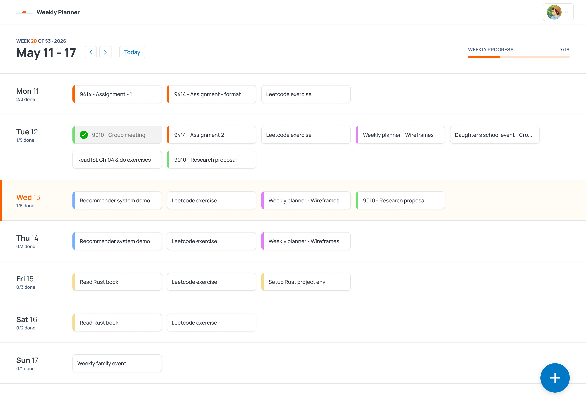
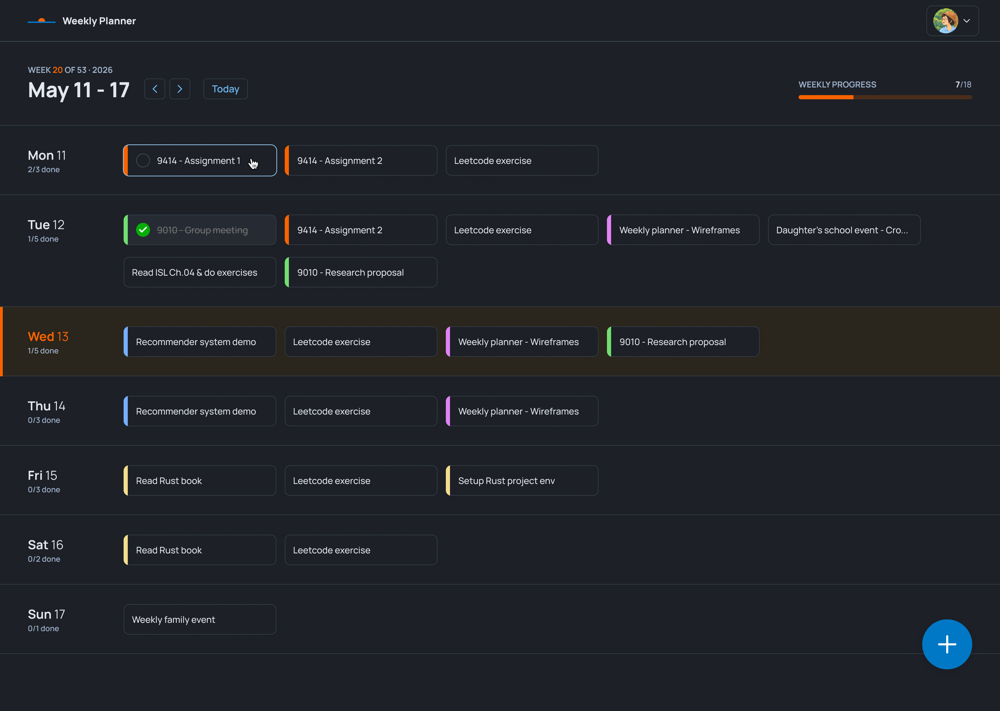

# Weekly Planner

Plan one-off and repeating tasks one week at a time, with Google sign-in and dark mode.

**[Live demo](https://weekly-planner-jing.vercel.app/)**

**[Figma Design](https://www.figma.com/design/PMOiVwojpmtcMso4lWKBma/weekly-planner?node-id=56-1821&t=dBZrKXyrhO8Yhz5a-1)**





## Features

- Add tasks to any days of the week, with optional colour labels and an end date
- Tick tasks off and see the week's progress
- Edit or delete a repeating task for **this task only**, or for **this and future tasks**, like Google Calendar
- Google sign-in, and account deletion that removes all of a user's data
- Light and dark themes: follow the system, or choose one from the profile menu

## How repeating tasks work

A task's details are stored as **rules** (`TaskRule`), and each rule applies over a date range.
Editing "this and future tasks" ends the current rule and starts a new one in a single database
transaction, so past weeks never change. Single-day changes are stored separately as overrides (`TaskOverride`) and skips (`TaskSkip`), leaving the rule untouched.

## Tech stack

Next.js (App Router) · React · TypeScript · Tailwind CSS 4 · Prisma · PostgreSQL (Neon) · Better Auth · Vitest · Vercel

## Running locally

Requires Node.js 24 and a PostgreSQL database.

1. `npm install`
2. Create `.env` with:
   ```
   DATABASE_URL=
   BETTER_AUTH_SECRET=
   BETTER_AUTH_URL=http://localhost:3000
   GOOGLE_CLIENT_ID=
   GOOGLE_CLIENT_SECRET=
   ```
   In Google Cloud, add `http://localhost:3000/api/auth/callback/google` as a redirect URI.
3. `npx prisma migrate deploy`
4. `npm run dev`, then open http://localhost:3000

## Tests

- `npx vitest run --project unit` runs the unit tests (dates, form parsing, building a week's tasks).
- `npx vitest run` also runs the database tests for the task actions. These need `TEST_DATABASE_URL` in `.env.test`, pointing at a separate database, because they clear it before each test.

## Design

Colours, type, components and interaction rules are documented in [`docs/DESIGN.md`](docs/DESIGN.md).
